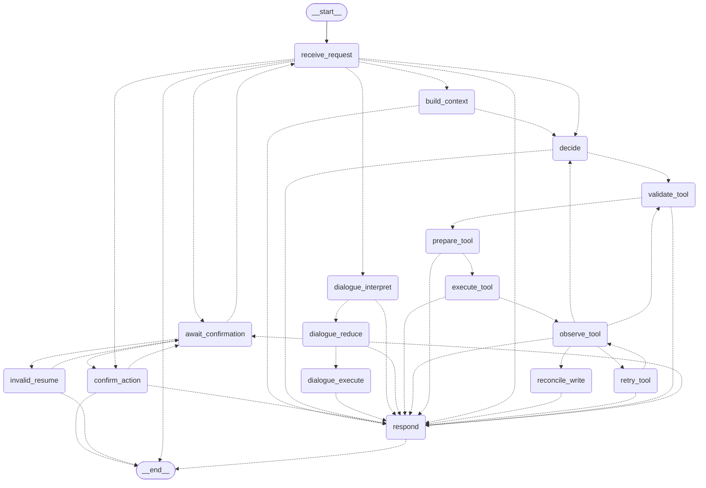

# VehicleMind 实机演示：敏感操作中断 → 跨进程确认 → 恢复

本文演示在 GitHub 界面上可直接查看的三类"实际操作"证据：

1. **可渲染的 Agent 状态机图**（LangGraph 生成，GitHub 原生渲染 Mermaid）
2. **可复现的终端操作记录**（真实命令 + 真实输出，脚本模型零 API 费用）
3. **GitHub Actions 在线评测实跑记录**（真实 API 调用，双模型 + judge 判分）

## 1. Agent 状态机全貌

以下由 `python -m apps.vehicle_ai_demo.langgraph_demo graph` 实时导出：



关键路径：`decide → validate_tool → prepare_tool → execute_tool` 是有界工具循环（受
`max_tool_rounds` / `max_tool_calls` / `graph_recursion_limit` 约束）；
`await_confirmation` 是敏感操作中断点——车机写操作（导航、音乐控制等）在此暂停，
等待显式 `confirm` / `reject`。

## 2. 终端实机操作记录（可复现）

以下输出为 2026-10-23 在仓库根目录实测捕获。每一步都是**独立进程**，
状态通过 LangGraph sqlite checkpoint 跨进程恢复——这正是"车载会话可在重启后继续"的模拟。

### 步骤 1：用户请求 → 敏感操作中断

```bash
.venv/bin/python -m apps.vehicle_ai_demo.langgraph_demo chat \
  --checkpoint-db /tmp/demo.sqlite3 --thread-id demo \
  --text 帮我找附近服务区并导航
```

输出（节选）：

```json
{
  "next": ["await_confirmation"],
  "pending_action": {
    "action_id": "57dd6ff54da04dfabac333c9befd9a27",
    "tool_name": "start_navigation",
    "arguments": {"poi_id": "rest_area_001"},
    "display_text": "确认导航至西湖服务区"
  },
  "graph_trace": [
    {"node": "receive_request", "task_status": "RUNNING"},
    {"node": "build_context",   "task_status": "RUNNING"},
    {"node": "decide",          "task_status": "RUNNING"},
    {"node": "validate_tool",   "task_status": "RUNNING"},
    {"node": "prepare_tool",    "task_status": "RUNNING"},
    {"node": "execute_tool",    "task_status": "RUNNING"},
    {"node": "observe_tool",    "task_status": "RUNNING"},
    {"node": "respond",         "task_status": "AWAITING_CONFIRMATION"}
  ]
}
```

要点：**导航未执行**（vehicle 状态中 navigation 为 null），图停在
`await_confirmation`，动作以不可猜测的 `action_id` 暂存。

### 步骤 2：新进程确认 → 恰好执行一次

```bash
.venv/bin/python -m apps.vehicle_ai_demo.langgraph_demo confirm \
  --checkpoint-db /tmp/demo.sqlite3 --thread-id demo \
  --action-id 57dd6ff54da04dfabac333c9befd9a27
```

输出（节选）：

```json
{
  "next": [],
  "result": {
    "success": true,
    "message": "模拟导航已开始，目的地：西湖服务区。",
    "data": {"poi_id": "rest_area_001", "navigation_state": "ACTIVE"}
  }
}
```

要点：图到达终点（`next: []`），导航状态变为 `ACTIVE`，
`graph_trace` 以 `confirm_action` 节点收尾——确认动作在图内留痕。
若用错误的 `action_id` 确认，pending action **不会被消耗**（见
`tests/vehicle_ai/test_tool_confirmation.py` 的回归覆盖）。

### 步骤 3：新线程拒绝 → 无副作用取消

```bash
.venv/bin/python -m apps.vehicle_ai_demo.langgraph_demo chat ... --thread-id demo2
.venv/bin/python -m apps.vehicle_ai_demo.langgraph_demo reject \
  --checkpoint-db /tmp/demo2.sqlite3 --thread-id demo2 \
  --action-id c52b0c4a35f141f394cb9518380f5c0e
```

输出（节选）：

```json
{
  "next": [],
  "result": {"success": true, "message": "Pending action cancelled."},
  "pending_action": null
}
```

## 3. GitHub Actions 在线评测实跑记录

以下为 GitHub 界面可直接点开的实跑证据（非本地宣称）：

| 证据 | 链接 | 说明 |
|---|---|---|
| 在线 judged eval（真实 API） | [Actions run 39938693568](https://github.com/CuitSuanNaiGaiGai/VehicleMind/actions/runs/39938693568) | qwen + glm 各 40 trials，rubric judge 判分，结果 artifact 可下载 |
| 注入门（prompt 注入防护） | 同上 job 1 | 4/4 PASS，确定性脚本判分 |
| 架构合并 PR | [PR #29](https://github.com/CuitSuanNaiGaiGai/VehicleMind/pull/29) | graph 架构合并过程与 CI 全绿记录 |
| main 分支 CI | [Actions（main）](https://github.com/CuitSuanNaiGaiGai/VehicleMind/actions?query=branch%3Amain) | 每次 push 自动跑 874 项测试 + lint + 质量门 |

在线 eval 复现：Actions 页面选择 `Eval` 工作流 → Run workflow → 勾选
`judged`（需要 `DASHSCOPE_API_KEY` / `GLM_API_KEY` secrets，已配置）。

## 4. 复现说明

- 上述终端演示使用 `--provider scripted`（默认），零 API 费用、结果确定；
  换 `--provider qwen` 或 `glm` 可用真实模型复现（需 `.env` 密钥）。
- checkpoint 数据库（`/tmp/demo.sqlite3`）由首次调用自动创建，删除后即可重放全程。
